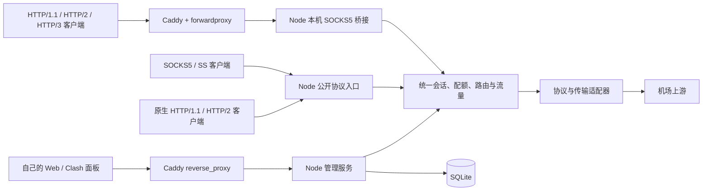

# NetworkProxy 最终核心设计

本文规定个人自用代理中转工具的完整核心行为。协议参数见 [protocols.md](protocols.md)，管理接口见 [api.md](api.md)，数据库见 [storage.md](storage.md) 与 [schema.sql](schema.sql)，部署与验收分别见 [operations.md](operations.md) 和 [acceptance.md](acceptance.md)。

## 1. 固定约束与产品定义

| 项目 | 决定 |
| --- | --- |
| 使用方式 | 单人自用，可以为自己的不同设备配置多组代理凭据 |
| 操作系统 | Windows Server x64，本机 NTFS 数据目录 |
| 应用运行方式 | 一个长期运行的 `node.exe`，单个 JavaScript 主事件循环 |
| 应用语言 | TypeScript strict，业务与代理协议均由项目实现 |
| 入口软件 | 允许额外运行 Caddy；协议入口使用明确选定的 forwardproxy 扩展 |
| 数据库 | SQLite，Drizzle ORM 管理模型与迁移，better-sqlite3 作为驱动 |
| 管理界面 | Vue 3、Vite、Naive UI，生产静态资源由应用提供 |
| 管理服务 | Fastify、Zod、WebSocket，HTTP 管理与代理监听器分别创建 |
| 数据转发 | Node 内置 net/http/http2/tls/dgram/stream/crypto；有界状态机与协议适配器 |
| 兼容接口 | Clash 控制 API 的明确子集及选定面板实际需要的扩展 |
| 核心目标 | 配置入口和凭据、连接机场、选择出口、控制并发与带宽、管理 TCP/UDP、观察与持久化运行信息 |

Node 运行基线选用仍受支持的 Node 24 LTS Windows x64 安全补丁版本，锁定实际验证过的精确版本；依赖通过锁文件固定。原生 SQLite 驱动、OpenSSL 等运行时依赖属于 Node 依赖，应用不分发另一个代理内核，不自行启动 Go/Rust 转发程序。Caddy 是用户明确允许的独立入口例外。

应用运行时不启动 cluster、子进程或数据库服务。Node 自身的异步 I/O 与内部线程池不属于额外应用进程。构建、安装和离线维护工具可以在应用停止时运行。

## 2. 最终范围与能力诚实性

最终核心需要形成以下完整闭环：

1. 管理员在 Web 配置入口、自己的连接凭据、并发/带宽、节点、订阅、组、路由和 DNS 策略。
2. HTTP/1.1、HTTP/2、HTTP/3、SOCKS5 与 Shadowsocks 客户端通过对应入口接入。
3. Node 按统一准入、路由和协议能力选择上游，完成 TCP 或 UDP 转发。
4. Web 与 Clash 面板读取同一份连接、组选择、流量和运行配置，切换或断连即时落实到实际对象。
5. SQLite 持久化配置与累计统计，进程重启、配置失败和备份恢复都有确定行为。

“尽可能多协议”通过协议、传输、安全层与 UDP 承载的组合矩阵实现。核心要求包含 HTTP CONNECT、SOCKS5、SS AEAD2017、指定 SS2022 AES 方法、Trojan、VMess AEAD、VLESS 基础命令及 SSH TCP 出站，具体合法组合以协议文档为准。导入器能识别的协议不自动获得运行能力。

Hysteria2/TUIC 等 QUIC 协议、REALITY/XTLS Vision、WireGuard 等需要单独列出实现条件。它们不得只因为模型接受同名字段就出现在已支持列表。`CapabilityRegistry` 分开记录交付要求 `requirement=required|conditional` 与运行可用性 `availability=available|unavailable`，并附原因。最终验收只允许已真实实现和互通过的能力报告 available；核心要求不可用时整项验收失败。条件能力的边界属于最终产品明确的运行条件与支持范围。

HTTP/3 正向入口由 Caddy forwardproxy 承担；这不要求 Node 原生 QUIC。HTTP/3 CONNECT 在此架构中提供 TCP 隧道；UDP 由原生 SOCKS5/SS 入口处理，CONNECT-UDP/MASQUE 是另外的能力。

## 3. 运行拓扑



全系统有一个 Node 核心进程、一个 Caddy 入口进程。Caddy 不执行机场节点选择、用户配额和业务路由。Caddy forwardproxy 始终指向 Node 桥接入口，未配置或失联时拒绝转发，禁止默认绕过 Node 直连目标。

推荐监听布局如下，所有端口均可配置并进行占用验证：

| 入口 | 默认示例 | 暴露范围 |
| --- | --- | --- |
| Caddy HTTP 正向代理 | TCP/UDP 443 | 公开，外部单一 owner 认证 |
| Caddy 管理网站/API | TCP/UDP 9443 | 可信来源，HTTPS 和应用鉴权 |
| Node 管理服务 | 127.0.0.1:19090 | 本机，经 Caddy 提供外部访问 |
| Node Caddy 桥接 | 127.0.0.1:11080 | 本机，NOAUTH，固定映射 edge-owner |
| Node SOCKS5 | TCP 1080，UDP 固定中继端口 1080 | 公开，用户名密码认证 |
| Node SS | 每组密钥一个 TCP/UDP 端口，例如 8388 | 公开，协议密钥认证 |
| Node 原生 HTTP | 例如 TCP 18080 或 TLS 18443 | 按需开启；同一核心支持 h1/h2 |

模板使用独立管理端口，避免正向代理的任意 authority 与管理站点路由冲突。一个端口的 TCP/UDP 可以由不同监听器占用，但必须显式规划。SOCKS UDP 广告地址、固定 UDP 端口和 Windows 防火墙规则一起配置。

## 4. 模块边界

| 模块 | 所有权与责任 |
| --- | --- |
| Bootstrap | 单实例锁、密钥、数据库、迁移、恢复和启动依赖顺序 |
| ConfigCoordinator | 串行变更、revision、验证、影响计划、发布与回滚 |
| ConfigStore | 已应用的不可变运行配置；数据转发仅读快照 |
| CapabilityRegistry | 合法协议组合、运行时依赖、UDP 能力与错误解释 |
| ListenerManager | 每个监听器的绑定、启停、重绑定和接入状态 |
| CredentialService | 验证凭据、缓存有界验证结果、吊销和轮换 |
| AdmissionController | 全局/入口/凭据会话名额，预认证与拨号数量限制 |
| ConnectionRegistry | 会话 ID、对象引用、状态、元数据、关闭与取消 |
| Router | 规则编译、匹配、组选择、循环检测与能力过滤 |
| UpstreamRegistry | 创建并复用协议连接器，处理健康状态与熔断 |
| TransportRegistry | TCP、TLS、WebSocket、HTTP/2/gRPC 等传输适配 |
| DnsService | bootstrap DNS、明确的目标解析策略、TTL 和有界缓存 |
| TrafficMeter | 唯一载荷计数、速率采样、进程与持久累计 |
| RateScheduler | 全局/入口/凭据共享额度、有界队列与公平调度 |
| SubscriptionService | 下载、格式识别、能力检查、稳定节点合并和变更预览 |
| ManagementApi | 自有 API、登录、配置编辑与管理操作 |
| ClashAdapter | Clash 请求/响应和流式协议适配，不拥有另一套路由或统计 |
| CaddyController | 受管配置生成、hash、加载、应用状态、漂移与回滚 |
| Storage | 短事务、参数化查询、统计 checkpoint、备份和迁移 |

管理框架只服务管理 HTTP 请求。代理 HTTP/2 使用底层 http2 核心 API；代理 Socket 不通过普通 REST 中间件处理。

## 5. 领域模型

- **Credential**：自己某台设备或用途的一组凭据；具有稳定 ID、启用状态、可选失效时间和覆盖限额。
- **Listener**：协议、绑定、认证映射、协议参数、可选独立资源限制。
- **OutboundNode**：机场节点的协议、服务地址、传输、安全层、密钥引用和能力。
- **ProxyGroup**：可引用节点或组的有向无环图；维护手选、自动探测、故障转移或会话级负载策略。
- **RouteRule**：有序条件与出口动作。条件包括入口、凭据、TCP/UDP、域名、地址网段和端口。
- **ProxySession**：用户可观察和限制的代理工作单位；不等于 OS Socket 或 HTTP/2/QUIC 物理连接。
- **UdpAssociation / UdpFlow**：认证的控制关联与目标流分别计数，均有容量和空闲期限。
- **ConfigRevision**：一份完整不可变配置的版本。编辑中的表和已运行版本可以暂时不同，状态必须显示。
- **Run**：一次 Node 进程运行；Clash 运行累计、日志和实时状态归属于它。

数据库使用 ID 关联，节点名称为外部展示和 Clash 查找键。名称唯一；保留 `DIRECT`、`REJECT`、`GLOBAL`。组重命名、节点删除、订阅替换必须验证所有引用。

## 6. 统一转发接口

协议入口只负责协商和提取目的地，业务转发通过统一调度器。以下为契约示意，最终类型还须包含有界资源与错误枚举：

```ts
type Target =
  | { kind: 'domain'; host: string; port: number }
  | { kind: 'ipv4' | 'ipv6'; host: string; port: number };

interface DialContext {
  sessionId: string;
  credentialId: string;
  listenerId: string;
  revision: number;
  deadline: number; // 单调时钟的截止时间
  signal: AbortSignal;
}

interface ProtocolCapabilities {
  tcp: boolean;
  udp: 'none' | 'native' | 'framed-stream' | 'quic-datagram';
  domainTarget: boolean;
  ipv6Target: boolean;
}

interface UpstreamAdapter {
  capabilities: Readonly<ProtocolCapabilities>;
  dialTcp(target: Target, context: DialContext): Promise<import('node:stream').Duplex>;
  openUdp(context: DialContext): Promise<DatagramChannel>;
}

interface DatagramChannel {
  send(target: Target, payload: Uint8Array): Promise<void>;
  close(reason: string): void;
  // 接收必须保留来源地址、数据报边界；队列与最大数据报受策略约束。
}
```

TCP 适配器返回通往目标的字节流，不暴露机场握手。UDP 适配器保留数据报边界；用字节流承载 UDP 时在适配器内编码和解析。HTTP CONNECT 出站只能承载 TCP，不能用它伪装 UDP 支持。

## 7. 并发与会话生命周期

主流程为 `accepted → parsing → authenticated → admitted → dialing → relaying → draining → closed`。任何分支最终进入一个幂等清理函数。

配额检查、全局/入口/凭据计数增加在同一个不跨 await 的同步区间完成。所有维度一起检查、一起增加；拨号和认证后的排队时间占会话名额。重试保留同一名额；错误、超时、取消、主动断连不能造成重复释放。

计数口径：

| 类型 | 一个会话 |
| --- | --- |
| 原生 HTTP 普通转发 | 一个进行中的 HTTP 请求；入站 keep-alive 不等于一直占业务会话 |
| HTTP CONNECT | 一条隧道；h2/h3 每个流单独计数 |
| SOCKS5 CONNECT / SS TCP | 一条目标隧道 |
| Caddy bridge | 一个实际存活的 Node 桥接 TCP 隧道；原版模块不传递原始 HTTP 请求信息 |
| UDP | 控制关联和目标流分别限额，不与 TCP 会话混算 |

另设客户端 Socket 数、HTTP/2 session 数、每 session 最大 stream 数、握手中数量、并行上游拨号数。HTTP/2 一条连接上的多个 CONNECT 必须分别占额度，避免复用绕过并发限制。

HTTP 普通请求按请求认证；保持连接不能跨凭据复用未经重新验证的状态。原生正向 HTTP 不把代理认证发往目标；默认每请求使用独立目标隧道并在响应结束关闭，避免池化使会话归属含糊。共享 h2 传输的每条业务流仍有独立租约。

## 8. 路由、节点组和故障行为

路由优先级固定为：入口/凭据显式策略 → 按顺序的规则 → 默认代理组。`GLOBAL` 模式选择全局组；`RULE` 模式执行规则；`DIRECT` 模式只有显式切换后生效。默认配置没有可用代理时拒绝，不因节点失败自动改为直连。

节点组提供：手选 selector、端到端探测 url-test、按优先级故障转移 fallback、按会话稳定哈希或轮转的 load-balance。实现自有模型，再适配目标 Clash 面板的类型和字段。

选择前先过滤 TCP/UDP、域名、地址族和传输能力；组内没有匹配节点时返回 `NO_COMPATIBLE_OUTBOUND`。多层组验证无环，运行时有最大递归深度。UDP 流创建时固定出口，避免每包切换。

只有尚未发送应用载荷的拨号失败可在组内有限重试；发送后不自动重放。切换节点影响新会话，已有隧道保留原出口，或由用户显式选择断开。探测走真实协议隧道并单独计入控制流量。

## 9. DNS、UDP 与限速

目标域名默认交给支持域名的上游解析。上游服务域名使用 bootstrap DNS；不通过自身递归查询。为 IP 规则本地解析必须显式开启，并显示其影响；IP 字面量不会被强行反查。

允许配置系统 DNS、固定解析服务器或经过已选代理的 DoH，但必须区分解析上游节点所需的 bootstrap 与目标解析，避免环。缓存具有 TTL、负缓存期限、条目上限和地址族策略。

UDP 具有独立的关联、目标流、空闲回收、来源校验与字节队列上限。SOCKS 关联绑定其 TCP 控制连接；共享 UDP 监听依据认证关联、来源端点和目的地映射会话。SS 先验证密文再创建流。来源端口变化默认新建认证关联，不凭相同 IP 接管其他会话。UDP 不保证可靠传输；超速短排队，超时或队列满丢包并统计。

上下行令牌桶按全局、入口、凭据共享。单调时钟驱动，调度器按会话轮转；大的数据块可切分，不能因大于桶容量永久阻塞。TCP 通过暂停读取形成背压；UDP 丢包策略显式记录。

## 10. 统计与日志

统一转发层只统计一次已认证的应用载荷字节。上行为客户端到目标，下行相反；协议握手、TLS/SS 封装开销、订阅和测速分开记录。数据报只有验证通过后才进入业务计数。

运行时总量用 bigint；Clash 按兼容合同输出 number，自有 API 用十进制字符串提供精确累计。超出安全整数范围时明确兼容表示的精度边界，不悄悄截断持久数据。

中央采样器每秒计算一次速率并广播，累计统计每 5 秒以 run checkpoint 批量写入 SQLite。异常退出允许丢失最近未落盘窗口，属于个人统计而非精确计费。流量推送与连接快照不按每个订阅者重复遍历。

Pino 输出有界、可轮转日志。审计记录配置修改与管理动作；不记录载荷、完整 URL 查询 token、SS/机场密钥和管理令牌。连接历史为摘要，可关闭，默认保留 7 天；聚合流量默认保留 90 天，留存设置可配置。

## 11. 配置发布与 Caddy 协调

所有 Web、Clash、订阅和管理命令的配置修改进入同一个 ConfigCoordinator。变更携带 expectedRevision；过期返回冲突。内部对完整候选配置验证，不能只校验单个字段。

基本步骤：验证 → 计算影响 → 准备新资源 → SQLite 提交 pending revision → 发布 Node 快照 → 应用受管 Caddy 配置（如有变化）→ 标记 applied/last-good → 旧资源排空。

Node、SQLite、Caddy 不是一个分布式事务，不能宣称原子提交。必须记录 desiredRevision、nodeAppliedRevision、caddyAppliedConfigRevision、lastGoodRevision、applyState 和错误。Caddy 自身 revision 是独立命名空间，必须通过 sourceConfigRevision 映射后才与应用 revision 比较。操作的最终 succeeded 状态代表本次需要的组件均已确认；自有 API 的 HTTP 202 只表示持久化接受操作。部分生效显示 applying/degraded，不伪装最终成功。Clash 同步变更仍须在确认实际生效后返回兼容成功响应。

端口占用尽量在提交前发现。新端口可先准备并暂停接入；同端口协议切换有受控重绑定中断。变更管理监听地址、证书、安全根密钥和模块构建等可要求重启，影响计划明确列出。Node 快照发布本身是短同步操作，外部调用在准备或协调阶段执行。

Caddy 受管配置由固定版本的 JSON 生成器产生，通过本机 Admin API 应用；运行时不 spawn 命令行。SQLite 只保存秘密引用模板，认证信息在内存渲染。关闭 Caddy 配置持久化，Caddy 从无代理权限的 bootstrap 启动后由 Node 重新加载受管配置；不将含明文认证的配置写入 autosave。配置与模块 hash 可观测；检测手工改动时报告 drift。应用失败恢复 last-good；结果不确定时读取实际配置核对，核对失败将相关桥接入口暂停新会话。恢复不能复活已断开的连接。

凭据禁用默认拒绝新连接并关闭其现有会话。密码轮换可选择保留或断开已认证会话；降低并发默认不强踢已有会话，停止新接入直到降到限额内，显式“立即执行”才按策略关闭。

## 12. Web 界面最终功能

| 页面 | 需要完成的行为 |
| --- | --- |
| 仪表盘 | 就绪/降级、Node/Caddy revision、TCP/UDP 会话、速率、累计、错误、事件循环延迟 |
| 入口 | HTTP 版本、绑定、TLS/证书、SOCKS UDP 广告地址、SS 方法与密钥、启停、应用影响 |
| 凭据 | 自己设备/用途的凭据、轮换、到期、共享上限、连接查看与吊销 |
| 节点与订阅 | 手动、URI/Clash YAML 导入、能力诊断、更新预览、稳定合并、失败保留 |
| 代理组 | 成员、当前选择、TCP/UDP 可用性、探测结果与故障策略 |
| 路由与 DNS | 有序规则、默认出口、域名解析方式、规则测试解释 |
| 连接 | 过滤、来源是否可知、目的地、出口链、状态、上传下载、主动断开 |
| 统计与日志 | 进程统计、累计/时间段聚合、错误筛选、脱敏审计 |
| 系统 | 资源限额、超时、Caddy 状态、备份恢复、维护停机、配置导入导出 |

前端只展示能力注册表允许的组合，不把未支持协议包装成可用选项。修改前可验证和预览影响，修改后展示实际应用状态。密钥默认掩码，显示/导出为显式动作。

## 13. 可调资源预算

以下是保守的默认配置，不是机器吞吐承诺；目标硬件上的验收确定调优值。NULL 表示可取消的业务限制，基础内存与协议防护上限始终有硬上限。

| 项目 | 默认 |
| --- | --- |
| 活跃 TCP 代理会话 | 256 |
| 原始客户端 Socket | 512 |
| 并行入站握手 / 上游拨号 | 64 / 64 |
| 每 h2 session 并发流 | 64 |
| SOCKS UDP 关联 / UDP 目标流 | 32 / 512 |
| 入站握手期限 / 上游总拨号期限 | 10 秒 / 15 秒 |
| TCP 空闲 / 半关闭排空期限 | 300 秒 / 30 秒 |
| UDP 流空闲期限 | 60 秒 |
| 单会话待发送字节 / 全局排队字节 | 256 KiB / 32 MiB |
| 单握手缓冲 | 64 KiB，协议更小上限优先 |
| 管理 WebSocket 客户端 | 8 |
| WS 每客户端待发送 / 日志环 | 1 MiB / 2 MiB |
| UDP 全局排队 | 8 MiB，有期限，超过即丢弃 |
| 订阅响应解压后大小 / 节点数 | 8 MiB / 2000 |
| DNS 缓存条目 | 4096 |
| 速率采样 / 统计落盘 | 1 秒 / 5 秒 |
| 停机排空期限 | 30 秒 |

进一步限制每 IP 未认证连接、认证失败频率、每 UDP 关联目标数量和重放缓存容量。对于 Caddy 桥接，Node 看不到原始 IP，边缘预认证的资源限制须由 Caddy 层承担；不能用 loopback 地址实施所有外部客户端的 IP 惩罚。

## 14. 单进程性能规则

转发路径不做 SQL、同步文件 I/O、逐块 JSON 日志或全局连接扫描。协议解析用分段缓冲，避免反复 Buffer.concat 导致平方复杂度。密码派生使用异步接口和有界并发；重复握手验证缓存有容量、期限和认证版本。

SQLite 同步调用包装成 async 不会消除阻塞。查询须有索引、分页和行数上限；写入短事务，忙等待很短并通过任务调度异步重试。在线维护不执行长 VACUUM 或无界扫描。

CPU 密集的协议编解码按有界帧处理，让出调度机会；不要一次处理整个订阅或大日志导出。保持一个应用进程，通过背压、资源上限、减少复制和采样优化；设计不依赖后续横向扩容兑现当前功能。

### 14.1 订阅与导入

导入器支持 Clash YAML、URI 列表及 Base64 URI 列表，对 ss/ss2022、socks、HTTP、Trojan、VMess、VLESS 和 SSH 按明确格式解析。整个远端 YAML 只作为节点/组/规则的候选数据，禁止远端订阅修改本机管理地址、Admin API、脚本、文件路径、凭据或任意程序选项。

YAML 禁用自定义对象标签并限制别名、深度和条目数量。响应按解压后大小限额，下载有总期限、重定向次数、并发与循环限制。订阅抓取出口可显式指定；无出口时用专门的 bootstrap 下载策略，不在正常代理失败后临时改为直连。

更新先规范化、提取秘密和能力诊断，再生成差异预览，最后通过配置协调器提交。优先采用来源的稳定 ID；无 ID 时用规范化端点、协议与传输身份作 sourceKey，密码轮换不改变 ID。重复端点有歧义时显示冲突并要求明确合并规则，不按数组位置盲目覆盖。

未知协议保留脱敏诊断为 unsupported 并禁用；不能忽略 REALITY/flow/plugin 字段后以普通 TLS 节点启用。HTTP 错页、空订阅、格式错误或部分解析失败不会静默清空仍被引用的节点。来源删除节点先失效并展示引用修复；只有完整验证的候选集能够更新运行配置。原始订阅正文不持久化。

### 14.2 初始化与管理安全

没有默认管理员密码。首次初始化通过本机交互命令输入密码；无人值守安装可消费一个受 NTFS ACL 保护的单次初始化文件，完成后删除，不将明文写入普通日志或任务参数。初始化完成前只允许本机设置访问，公开代理入口保持拒绝状态。

管理员密码保存异步 scrypt 哈希；代理导出凭据、SS 和机场密钥使用外部主密钥进行 AEAD 加密。Clash token、Web 会话与代理凭据分开。Caddy 外部认证引用可导出的受保护 proxy 凭据，Node 的 edge-owner 则是没有密钥的 internal-bridge 身份，两者通过入口配置关联，不假装 SOCKS 能传递外层用户名。

管理 Cookie 使用 Secure/HttpOnly/SameSite 与 CSRF/Origin 检查；Clash REST/WS 支持各自约定的 Bearer/token 方式。目标 URL、订阅重定向与测速不得访问本机管理接口、Caddy Admin 或递归指向自己的公开代理。代理到私网目标只能由明确规则允许，不能由 DNS 重绑定绕过地址策略。

管理 API 有请求大小、速率、导出和密码校验限额。仅受信 Caddy 管理路径可提供真实来源转发头；普通公开客户端的同名头不能改变认证、路由或来源身份。

## 15. 仓库与代码布局

```text
apps/
  server/src/
    bootstrap/          启动、恢复、停止
    config/             schema、编译、revision、发布
    core/               会话、准入、路由、流量、限速
    protocols/
      http/ socks5/ shadowsocks/ trojan/ vmess/ vless/ ssh/
    transports/         tcp、tls、ws、http2、grpc
    dns/ subscriptions/ caddy/
    api/management/ api/clash/
    storage/ security/ observability/
  web/src/              页面、客户端、状态和组件
packages/contracts/     自有 API 与配置类型，不包含运行时 Socket
tests/
  unit/ protocol-vectors/ interoperability/ compatibility/ windows/
docs/ deploy/
```

使用 workspace 管理同仓库代码，不引入微服务。跨模块依赖通过核心接口和类型，不能让 Web 直接修改 Socket、让 Clash 适配器直接写表、或让单个协议独立计算全局流量。

## 16. 完成定义

设计文档不是运行程序。最终核心交付必须满足 [acceptance.md](acceptance.md) 中全部必需项，并提供精确运行时、依赖、Caddy 模块、面板版本与互通结果。全部核心功能按同一完成标准验收，不以“能开端口”“能导入订阅”或“页面展示成功”替代协议互通与实际约束。

## 17. 核验来源

- Node HTTP/2 CONNECT：[官方文档](https://nodejs.org/api/http2.html#connect)。
- Node 网络与背压：[net](https://nodejs.org/api/net.html)、[stream](https://nodejs.org/api/stream.html)、[dgram](https://nodejs.org/api/dgram.html)。
- Node QUIC：[v24.x 分支文档](https://github.com/nodejs/node/blob/v24.x/doc/api/quic.md)，标注实验状态；分支存在文档不代表特定发布二进制提供模块。
- Caddy：[协议选项](https://caddyserver.com/docs/caddyfile/options#protocols)、[reverse_proxy](https://caddyserver.com/docs/caddyfile/directives/reverse_proxy)。
- Caddy forwardproxy：[README](https://github.com/caddyserver/forwardproxy)、[实现](https://github.com/caddyserver/forwardproxy/blob/master/forwardproxy.go)，支持 h1/h2/h3 和本机 SOCKS5 upstream，模块本身标注 experimental。
- Clash/Mihomo：[控制 API](https://wiki.metacubex.one/api/)。

2026-10-27 在当前 Windows x64 环境中，Node v24.15.0 使用 `--experimental-quic` 动态导入 `node:quic` 返回 `ERR_UNKNOWN_BUILTIN_MODULE`。此证据只说明该二进制不可用，不能推导 Windows 整体不支持 QUIC。项目的正常运行不依赖这个模块。
